

<a href="https://exentas.com/">
  
</a>

  

 

  

<picture>
  <source media="(prefers-color-scheme: dark)" srcset="assets/title-about-dark.svg" />
  
</picture>


  

<picture>
  <source media="(prefers-color-scheme: dark)" srcset="assets/title-stack-dark.svg" />
  
</picture>


  

<picture>
  <source media="(prefers-color-scheme: dark)" srcset="assets/title-work-dark.svg" />
  
</picture>

<table>
  <tr>
    <td width="50%"><a href="https://lambowebsiteprojectredwanrahat.vercel.app/"></a></td>
    <td width="50%"><a href="https://redlunar-esports.vercel.app/"></a></td>
  </tr>
  <tr>
    <td width="50%"><a href="https://www.solasarc.com/"></a></td>
    <td width="50%"><a href="https://note-taking-website-seven.vercel.app/"></a></td>
  </tr>
  <tr>
    <td width="50%"><a href="https://blusshy.com/"></a></td>
    <td width="50%"><a href="https://uni-parking-project.vercel.app/"></a></td>
  </tr>
</table>

 

<picture>
  <source media="(prefers-color-scheme: dark)" srcset="assets/title-pulse-dark.svg" />
  
</picture>


  

<a href="mailto:rahatofc912@gmail.com">
  
</a>

